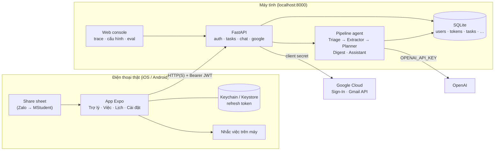
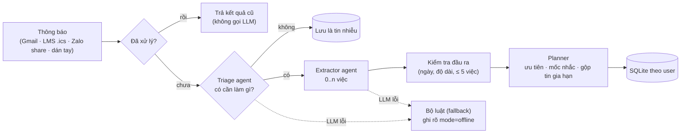
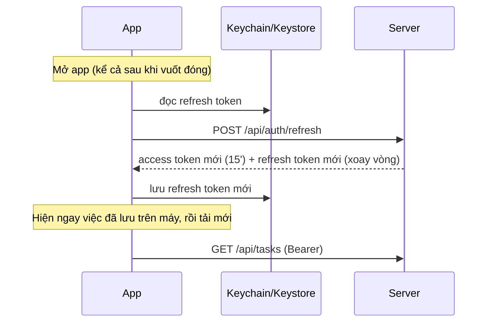

# Kiến trúc MStudent v1.0

> AI inbox cho sinh viên: gom thông báo rải rác (email trường, LMS, nhóm Zalo lớp) và biến chúng thành việc cần làm có
> hạn, ưu tiên và nhắc việc. Thiết kế theo thang điểm: **AI chạy trực tiếp trên điện thoại thật**, **vấn đề thật có bằng
> chứng**, **mở rộng được**.

## 1. Tổng quan



Nguyên tắc: **mọi bí mật ở server** (khoá LLM, client secret Google, khoá ký). App chỉ giữ refresh token của chính MStudent.

## 2. Thành phần

| Thư mục | Vai trò |
|---|---|
| `app/routers/auth.py` | Đăng ký, đăng nhập (mật khẩu / Google), làm mới token, đăng xuất, đổi mật khẩu, xoá tài khoản |
| `app/routers/core.py` | Thông báo → việc, việc, trợ lý chat, bản tin, thống kê, trace, kiểm tra AI, quản trị |
| `app/routers/google.py` | Kết nối Gmail, quét thư, ngắt kết nối |
| `app/pipeline/` | Các agent (xem mục 3) |
| `app/security.py` | Argon2id, JWT, refresh token, Fernet, giới hạn tần suất |
| `app/db.py`, `repo.py` | Schema SQLite và truy vấn (luôn lọc theo `user_id`) |
| `app/google_api.py` | Kiểm ID token, đổi mã uỷ quyền, Gmail REST |
| `app/static/` | Web console cho nhà phát triển (không phải kênh demo) |
| `mstudent-app/` | App Expo cho iOS + Android |

## 3. Pipeline agent



| Agent | Kiểu | Ghi chú |
|---|---|---|
| **Triage** | LLM (OpenAI Agents SDK), output có schema | Không có tool. Lọc quảng cáo, chuyện phiếm |
| **Extractor** | LLM, output có schema | Không có tool. Suy ra ngày tương đối từ thời điểm nhận tin |
| **Planner** | Python | Ưu tiên theo hạn, mốc nhắc 7d/3d/1d/2h, gộp tin gia hạn vào việc cũ |
| **Digest** | LLM / template | Bản tin 7 ngày |
| **Assistant** | LLM + 4 tool | `list_tasks`, `add_notice`, `complete_task`, `get_digest` — `user_id` gắn ở server |

Mọi lượt chạy ghi **trace** (agent, loại `llm`/`rules`, thời gian, đầu ra). App và web console hiện `mode` để không bao giờ
gọi nhầm kết quả của bộ luật là AI. `POST /api/ai/check` gọi thật một lượt LLM để xác nhận trước khi demo.

## 4. Dữ liệu (SQLite)

```
users(id, email UNIQUE, name, password_hash?, google_sub?, created_at, last_login_at)
refresh_tokens(id, user_id→users, token_hash UNIQUE, family, device, created_at, expires_at, revoked_at)
google_accounts(user_id→users, email, refresh_token_enc, scopes, connected_at, last_sync_at)
messages(user_id→users, id, source, sender, subject, body, received_at, relevant, category, reason)
tasks(id, user_id→users, title, course, category, due_at, location, action, priority, source,
      message_id, status, reminders[], updated_from[], created_at, done_at)
traces(id, user_id→users, message_id, created_at, mode, summary, steps[])
settings(key, value)            -- model + prompt, toàn hệ thống, chỉ admin sửa
audit_log(id, at, user_id, event, ip, detail)
```

Khoá ngoại `ON DELETE CASCADE`: xoá tài khoản là xoá hết dữ liệu của người đó. WAL bật sẵn. Phiên bản schema ở `PRAGMA user_version`.

## 5. API

Tất cả cần `Authorization: Bearer <access token>` trừ nhóm Công khai và `/api/auth/{register,login,google,refresh,logout}`.

| Nhóm | Endpoint |
|---|---|
| Công khai | `GET /api/health` · `GET /api/public-config` |
| Tài khoản | `POST /api/auth/register` · `login` · `google` · `refresh` · `logout` · `logout-all` · `change-password` · `GET/DELETE /api/auth/me` |
| Thông báo | `POST /api/ingest` · `/api/ingest/zalo` · `/api/ingest/lms-ics` · `/api/demo/seed` |
| Việc | `GET /api/tasks` · `POST /api/tasks/{id}/done` · `PATCH /api/tasks/{id}` |
| AI | `POST /api/chat` · `GET /api/digest` · `POST /api/ai/check` · `GET /api/traces` · `GET /api/stats` |
| Gmail | `GET /api/google/status` · `POST /api/google/connect` · `POST /api/google/gmail/sync` · `DELETE /api/google/disconnect` |
| Quản trị | `GET/PUT /api/agents/config` · `POST /api/agents/config/reset` · `POST /api/eval` · `GET /api/admin/audit` · `GET /api/admin/overview` |

Tài liệu tự sinh: `http://localhost:8000/docs` (tắt khi `MSTUDENT_ENV=prod`).

## 6. Phiên đăng nhập trên điện thoại (cốt lõi của tiêu chí "đóng hẳn rồi mở lại")



- Server không gọi được → vẫn vào app với dữ liệu đã lưu, **không** bắt đăng nhập lại.
- App bị tắt giữa lúc đổi token → server chấp nhận token cũ trong 30 giây ân hạn, không khoá phiên.
- Access token hết hạn giữa chừng → tự làm mới và gọi lại, người dùng không thấy gì.

## 7. Kết nối nguồn

Từ 002-auto-ingest: **kết nối một lần, máy chủ tự đồng bộ** (`app/sync/`, bộ lập lịch chạy trong tiến trình
web, trạng thái trong bảng `sync_connections`). Chi tiết: `specs/002-auto-ingest/`.

| Nguồn | Cách lấy | Tự động | Trạng thái |
|---|---|---|---|
| **Gmail** | Gmail API chỉ đọc; `history` tăng dần; tuỳ chọn Pub/Sub báo ngay → `/api/hooks/gmail` | 2 phút (≈ 1 phút khi có Pub/Sub) | Có, cần cấu hình Console |
| **Google Classroom** | Classroom API chỉ đọc: bài tập có hạn (không qua AI), bài đã nộp → xong, thông báo lớp qua AI | 10 phút | Có, cần bật API + scope |
| **Bảng lớp (Google Sheets)** | Link chia sẻ công khai → CSV; AI hiểu cột một lần | 30 phút | Có |
| **LMS** | URL lịch `.ics` (Moodle…), ETag | 60 phút | Có |
| **Zalo** | Share sheet (Android), Phím tắt iOS + deep link `mstudent://share`, dán đoạn chat | Thủ công | Có; tự động trên Android qua đọc thông báo: kế hoạch (002 US5) |
| Email trường (Outlook), Teams, Udemy | Chuyển tiếp email sang Gmail đã kết nối | Như Gmail | Có (không cần code) |
| Microsoft 365 trực tiếp | Microsoft Graph | — | Lộ trình bên dưới |
| Email khác | IMAP (`connectors/email_imap.py`) | — | Có mã, chưa nối API |

### Lộ trình Microsoft 365 (002 US6, sau cuộc thi)

1. Đăng ký ứng dụng đa tenant trên Microsoft Entra; quyền uỷ quyền chỉ đọc `Mail.Read`, `EduAssignments.ReadBasic`,
   `offline_access`. Tenant trường (vd `vnu.edu.vn`) thường chặn sinh viên tự đồng ý → cần CNTT trường **duyệt quyền
   cho cả tenant** (admin consent).
2. Thêm nguồn `msgraph` vào bộ lập lịch: thư mới qua delta query `/me/mailFolders/inbox/messages/delta`, bài tập qua
   `/education/me/assignments` (có `dueDateTime`, không cần AI); có thể nhận báo ngay bằng Graph change notifications.
3. Trong lúc chờ: hướng dẫn quy tắc chuyển tiếp Outlook → Gmail (màn hình Nguồn tự động).

## 8. Chạy và triển khai

Theo yêu cầu, backend chạy **localhost**: `python run_local.py` mở cổng 8000 trên mọi card mạng và in địa chỉ LAN để nhập
vào app. Chi tiết mạng, build app và kịch bản: `docs/DEMO_RUNBOOK.md`. Bảo mật: `docs/SECURITY.md`.

## 9. Chưa làm

- Zalo tự động trên Android (đọc thông báo trên máy, 002 US5); Microsoft 365 trực tiếp (lộ trình ở mục 7).
- Thông báo đẩy cho iPhone cần tài khoản Apple Developer (bản ký miễn phí chỉ làm mới nền).
- Múi giờ theo người dùng (đang cố định +07:00) và giao diện đa ngôn ngữ — cần cho thị trường ngoài Việt Nam.
- Xác minh email, quên mật khẩu, HTTPS mặc định (xem `SECURITY.md`).
